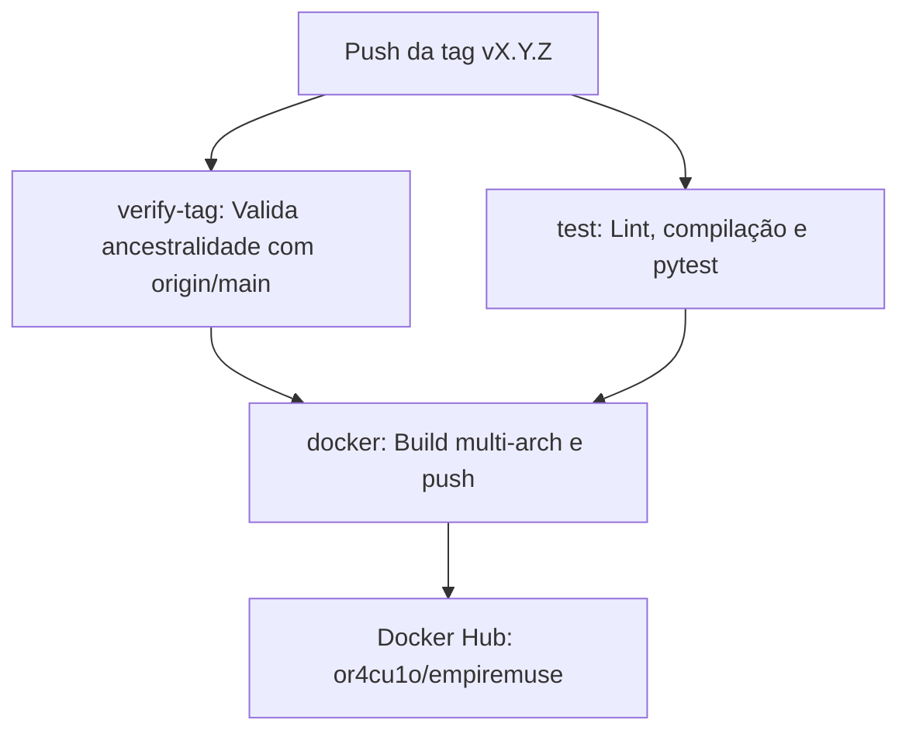

# Guia de Release e Publicação de Versões

Guia técnico para mantenedores do **EmpireMuse** detalhando a política de versionamento SemVer, o procedimento de publicação de versões, a esteira automatizada no GitHub Actions e a publicação de imagens multi-arquitetura no Docker Hub.

---

## 1. Estratégia de Versionamento (SemVer)

O EmpireMuse segue rigorosamente o padrão de [Versionamento Semântico 2.0.0](https://semver.org/lang/pt-BR/) (`MAJOR.MINOR.PATCH`):

- **MAJOR** (`X.0.0`): Mudanças incompatíveis na API, arquitetura ou nas configurações de banco de dados/execução.
- **MINOR** (`0.Y.0`): Novas funcionalidades mantendo compatibilidade retroativa.
- **PATCH** (`0.0.Z`): Correções de bugs, ajustes de documentação ou atualizações pontuais sem quebra de compatibilidade.

### 1.1 Versão do Projeto e Release Candidates

- **Versionamento**: O projeto adota [Semantic Versioning (SemVer)](https://semver.org/lang/pt-BR/). Em razão da reformulação profunda do bot frente ao upstream original, as publicações de teste da série 1.x foram retiradas e a primeira versão oficial do projeto é a **2.0.0**.
- **Disponibilidade das Tags**: As tags flutuantes `latest` e `2` (e `2.0`) só passam a existir no Docker Hub com a publicação oficial da versão estável `2.0.0`. Até lá, o registro mantém exclusivamente as tags de release candidate (`2.0.0-rc.N`, atualmente `2.0.0-rc.1`).
- **Fluxo de Release Candidates (`-rc.N`)**:
  - A cada merge concluído na branch `main`, o **MAESTRO** publica uma nova tag de release candidate no formato `v2.0.0-rc.N` (com `N` sequencial: `v2.0.0-rc.1`, `v2.0.0-rc.2`, etc.).
  - A publicação de uma release candidate compila e gera **estritamente a imagem com a tag exata** (`or4cu1o/empiremuse:2.0.0-rc.N`), **sem alterar nem promover** as tags flutuantes (`latest`, `2` ou `2.0`).
  - O objetivo das release candidates é validar cenários de deploy e plataformas externas (como o *egg* do Pterodactyl, Docker Compose e a plataforma Discloud) diretamente na infraestrutura real.
- **Promoção para a Versão Final (`2.0.0`)**:
  - A versão final estável `2.0.0` (tag `v2.0.0`) sairá **a partir do mesmo commit da última release candidate validada no deploy da VPS**, promovendo as tags flutuantes oficiais (`2.0.0`, `2.0`, `2` e `latest`).

---

## 2. Pré-requisitos de Configuração (Configuração Única)

A publicação automatizada de imagens no Docker Hub exige credenciais configuradas nos segredos do repositório no GitHub:

1. **Conta e Repositório no Docker Hub**:
   - Conta ou organização com acesso de publicação ao repositório `or4cu1o/empiremuse`.
2. **Personal Access Token (PAT) no Docker Hub**:
   - Gerar um token em **Account Settings > Security > New Access Token** com permissões de **Read & Write**.
3. **GitHub Actions Secrets e Environment `docker-release`**:
   - O proprietário do repositório deve configurar as variáveis de segredo no GitHub sem expor valores publicamente (seja a nível de repositório ou no ambiente **`docker-release`**, onde também é possível definir revisores obrigatórios para aprovar o deploy antes da publicação):
     - `DOCKERHUB_USERNAME`: Nome do usuário no Docker Hub (`or4cu1o`).
     - `DOCKERHUB_TOKEN`: Personal Access Token com permissão de escrita gerado no Docker Hub.
   
   A configuração pode ser realizada via interface web do GitHub ou pelo GitHub CLI (`gh`):
   ```bash
   gh secret set DOCKERHUB_USERNAME
   gh secret set DOCKERHUB_TOKEN
   ```

> [!NOTE]
> Essa configuração é feita apenas uma única vez. Se esses secrets não estiverem presentes, a etapa de autenticação no Docker Hub falhará durante o workflow de release.

---

## 3. Procedimento de Publicação Passo a Passo

Para manter a integridade do histórico do Git e a rastreabilidade das alterações, o fluxo de release deve ser executado rigorosamente na seguinte ordem:

### Passo 1: Atualizar o `CHANGELOG.md`

1. Na branch da tarefa/release, edite o arquivo [`CHANGELOG.md`](../../CHANGELOG.md);
2. Mova todas as alterações documentadas sob a seção `## [Unreleased]` para uma nova seção com o número da versão e a data correspondente:
   ```markdown
   ## [Unreleased]

   ## [2.0.0] - 2026-10-24
   ### Adicionado
   ...
   ```
   *(No caso de Release Candidate, utilize o formato `## [2.0.0-rc.1] - YYYY-MM-DD`)*;
3. Crie uma nova seção `## [Unreleased]` vazia no topo, pronta para os próximos ciclos de desenvolvimento.

### Passo 2: Submeter via Pull Request para a branch `main`

> [!IMPORTANT]
> A branch `main` possui proteção estrita contra commits diretos. Todas as alterações devem entrar via Pull Request.

1. Comite as alterações do `CHANGELOG.md` e abra um Pull Request apontando para `main`;
2. Aguarde a execução de todos os testes e verificações da esteira de integração contínua (CI);
3. Conclua o merge do PR na branch `main`.

### Passo 3: Criar a Tag Anotada no commit da `main`

Para uma **Release Candidate** (criada pelo MAESTRO a cada merge na `main` com `N` sequencial):

```bash
git checkout main
git pull origin main
git tag -a v2.0.0-rc.N -m "Release candidate v2.0.0-rc.N"
```

Para a **Versão Final Estável `2.0.0`** (apontando obrigatoriamente para o commit da última RC homologada na VPS, garantindo integridade mesmo se novos commits tiverem entrado na `main`):

```bash
git fetch origin --tags
VALIDATED_COMMIT="$(git rev-parse v2.0.0-rc.N^{})"
git tag -a v2.0.0 "$VALIDATED_COMMIT" -m "Release v2.0.0"
```

### Passo 4: Enviar a Tag para o Repositório Remoto

Envie a tag Git criada para o GitHub para disparar automaticamente o pipeline de release:

```bash
git push origin v2.0.0
```

---

## 4. O que o Workflow de Release Faz

O arquivo de workflow [`.github/workflows/release.yml`](../../.github/workflows/release.yml) é acionado exclusivamente no push de tags no formato `v*.*.*`. Ele é dividido em três fases coordenadas:



### 4.1 Validação de Tag (`verify-tag`)
- Executa `git merge-base --is-ancestor HEAD origin/main`.
- **Garantia de segurança**: Se a tag apontar para um commit que não pertence ao histórico da branch `origin/main` (por exemplo, uma tag acidental em uma branch de feature ou trabalho isolado), o workflow falha imediatamente e aborta a esteira, impedindo a publicação indevida de imagens.

### 4.2 Testes Automatizados (`test`)
- Prepara o ambiente com Python 3.13 e `uv` fixado em `0.13.1`;
- Executa a suíte de lint (`ruff check .`), conferência de formatação (`ruff format --check .`), validação de compilação de bytecode (`compileall`) e a suíte completa de testes (`pytest`).
- Se qualquer teste falhar, a imagem não é construída nem publicada.

### 4.3 Build e Push da Imagem (`docker`)
- Configura emulação **QEMU** e **Docker Buildx** para compilação multi-plataforma nativa;
- Autentica-se no Docker Hub utilizando os segredos `DOCKERHUB_USERNAME` e `DOCKERHUB_TOKEN`;
- **Multi-Arquitetura**: Constrói a imagem simultaneamente para `linux/amd64` (servidores x86_64 padrão) e `linux/arm64` (Apple Silicon, Raspberry Pi 4/5, servidores ARM na nuvem);
- **Segurança da Cadeia de Suprimentos (Supply Chain)**:
  - **SBOM** (`sbom: true`): Gera e anexa o inventário de software (Software Bill of Materials) diretamente ao registro;
  - **Provenance** (`provenance: mode=max`): Gera atestações criptográficas de procedência de compilação em conformidade com o nível SLSA;
- **Regras de Versionamento de Tags da Imagem**:
  - **Versão Final Estável** (`vX.Y.Z`, ex.: `v2.0.0`):
    - Publica a tag de versão exata `X.Y.Z` (`2.0.0`), que é imutável, além das tags flutuantes `X.Y` (`2.0`), `X` (`2`, gerada para versões ≥ 1.0 via `enable=${{ !startsWith(github.ref_name, 'v0.') }}`) e `latest` (graças ao modificador `latest=auto`), que são atualizadas a cada nova release estável.
  - **Release Candidate** (`vX.Y.Z-rc.N`, ex.: `v2.0.0-rc.1`):
    - Publica **estritamente** a tag do pré-lançamento (`2.0.0-rc.1`), **sem alterar nem sobrescrever** as tags flutuantes `2`, `2.0`, `latest` nem as tags de versões estáveis anteriores.

---

## 5. Como Conferir a Publicação

Após a conclusão com sucesso do workflow no GitHub Actions, realize a verificação externa:

### 5.1 Teste de Pull Anônimo
Em um terminal independente (ou sem autenticação no Docker Hub), teste o download da imagem publicada para validar que o repositório é público e acessível:

```bash
docker pull or4cu1o/empiremuse:2.0.0
```

*(Substitua `2.0.0` pela tag publicada, como `2.0.0-rc.1` ou `2`)*.

### 5.2 Inspeção do Manifesto Multi-Arquitetura
Utilize o comando `docker buildx imagetools inspect` para verificar as arquiteturas publicadas e os atestados de segurança:

```bash
docker buildx imagetools inspect or4cu1o/empiremuse:2.0.0
```

O comando exibirá a lista de manifestos contendo:
- Plataforma `linux/amd64`;
- Plataforma `linux/arm64`;
- Camadas de atestação (`application/vnd.in-toto+json`) referentes ao SBOM e Provenance.

---

## 6. O que Fazer em Caso de Erro na Tag ou na Release

> [!CAUTION]
> **NUNCA REAPROVEITE OU SOBRESCREVA UMA TAG DE RELEASE `vX.Y.Z` JÁ PUBLICADA!**

Apenas a tag de versão exata `X.Y.Z` (ex.: `2.0.0`) e as tags Git no repositório são estritamente imutáveis. As tags `X` (ex.: `2`), `X.Y` (ex.: `2.0`) e `latest` são **tags flutuantes** mantidas intencionalmente atualizadas para apontar para o release estável mais recente da série. No entanto, apagar uma tag remota (`git push origin :vX.Y.Z`) ou forçar a sua sobrescrita/movimentação (`git push --force origin vX.Y.Z`) quebra caches, invalida deploys reproduzíveis e compromete a rastreabilidade e integridade do projeto. Além disso, o ruleset de proteção do repositório (*Tags de release*) restringe a criação, atualização forçada e exclusão de tags `v*` exclusivamente a administradores do repositório.

Se for detectado qualquer defeito de código, falha de empacotamento ou inconsistência após a publicação:

1. Trate o problema normalmente via branch de correção (`fix/...`) e submeta o Pull Request para a `main`;
2. Após o merge na `main`, incremente o número da versão conforme as regras do SemVer:
   - Se o erro ocorreu em um Release Candidate (ex.: `v2.0.0-rc.1`), publique a versão subsequente `v2.0.0-rc.2`;
   - Se o erro ocorreu em uma versão final estável (ex.: `v2.0.0`), publique uma versão corretiva de patch `v2.0.1`;
3. Crie e envie a nova tag Git no commit atualizado da `main`.
